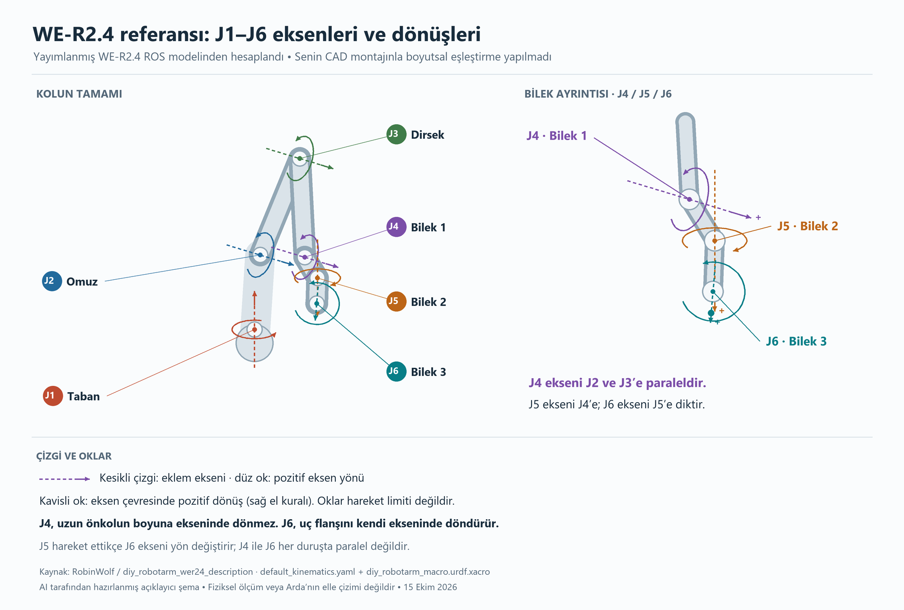

# ARM-01 - Sayısal hedeflerin gerekçesi ve eklem açıklaması

15 Ekim 2026. AI danışman önerisi olarak sürüm sözleşmesine işlenmiştir. Aşağıdaki sayılar üreticinin kapasite verisi, CAD'den ölçülmüş boy veya fiziksel test sonucu değildir. ARM-03 geometri, ARM-11 aktüatör/yük ve ARM-20 ölçüm sonuçlarıyla gözden geçirilecek.

## 1. Şemayı nasıl okuyacağız?

Bu şema RobinWolf ekibinin yayımladığı, uyarlanmış WE-R2.4 robotunun Xacro eklem zinciri ve kinematik parametrelerinden hesaplandı. Kullanıcının açtığı MakerWorld CAD montajının ölçüleriyle eşleştirilmedi. Kesikli çizgi dönme ekseni, düz ok eksenin pozitif yönü, kavisli ok sağ el kuralıyla pozitif dönüştür. Modelin gösterim duruşu kullanıcının ekran görüntüsündeki duruşla aynı olmak zorunda değildir. Oklar hareket limiti göstermez.

Tabandan uca zincir: **J1 taban -> J2 omuz -> J3 dirsek -> J4 bilek 1 -> J5 bilek 2 -> J6 bilek 3 -> flanş -> sabit takım/TCP**.

- **J1:** Sabit tabanın üzerindeki yapıyı düşey eksen çevresinde döndürür. Yalnız J1 değişirken J2-J6 yerel açıları sabit kalsa da hepsi uzayda taşınır.
- **J2:** Üst kolu omuzdan kaldırır/indirir; dirsekten sonraki bütün yapıyı da beraber taşır.
- **J3:** Önkolun üst kola göre açısını değiştirir. Bu bir açı farkıdır; dirsek hareketi bilek ve takımı da etkiler.
- **J4:** Önkolun ucundaki ilk bilektir. Eksen çizgisi J2 ve J3'e paraleldir; uzun önkolu kendi boyuna ekseninde burma hareketi değildir.
- **J5:** J4'e dik eksende döner; J6 ekseninin ve flanşın bakışını değiştirir. Şemada düşey görünmesi yalnız seçilmiş gösterim duruşuna aittir.
- **J6:** Son bilektir; flanşı kendi ekseninde döndürür. J6 ekseni J5'e diktir. J4 ve J6 her duruşta paralel değildir.

Eklem merkezi nokta, eksen ise o noktadan geçen doğrudur. Eksen çevresinde dönen, o eklemden sonra gelen bütün linklerdir. Her eklemin yerel ekseni `0 0 1` yazılabilse de yerel çerçeveler döndürüldüğü için bu eksenler dünya koordinatlarında aynı yönde değildir.

**Flanş ile TCP farklıdır.** Flanş takımın bağlandığı yüzeydir. TCP ise konum/yönelimini hedeflediğimiz takım referansıdır. İlk sürümde flanşa küçük sabit bir gösterge takılıp TCP onun ucunda tanımlanabilir. CAD'deki gripper'ın aç/kapa işlevi v1.0 kapsamında değildir. Sabit takılı kalırsa kütlesi uç yüküne, geometrisi modele dahil edilir.

## 2. Yaklaşık erişim ve görev alanı

**Öneri: Yaklaşık 400 mm flanş erişimi varsayımı.** Yayımlanmış WE-R2.4 uyarlamasındaki iki ana konum bileşeni 203.2 ve 177.8 mm mertebesindedir; toplamları 381 mm'dir. Bu yalnız ölçek fikri verir. Eklem ofsetleri, bilek ve takım, üç boyutlu ulaşılabilirliği değiştirir. 381 mm toplamı veya 400 mm varsayımı maksimum erişim ölçümü değildir; UR5 boyutları kopyalanmadı.

İlk test hedefleri için taban montaj düzlemi merkezinden başlayan geçici çerçevede: **X=150-250 mm, Y=-100...100 mm, Z=150-250 mm** aday görev kutusu önerilir. +X robotun ön tarafı, +Z yukarı kabul edilir; kesin çerçeve ARM-03'te dosyaya işlenecek. Kutu 100 x 200 x 100 mm boyundadır. Kutunun her noktası/her yönelimi erişilebilir ilan edilmez. IK, limit ve çarpışma kontrolünü geçen hedeflerden geçerli alt küme çıkarılır.

Neden dış sınırdan başlamıyoruz? Kol düzleşmeye yaklaştığında bazı yönelimler kaybolabilir ve tekillik yakınları ortaya çıkabilir. Çalışma alanı, yalnız bir erişim yarıçapı değil, kabul edilen hedef pozlar kümesidir. Fiziksel masa boyu ile görev kutusu da aynı şey değildir; gerçek düzenek ayrıca ölçülecek.

ARM-03'te CAD'den dönme eksenleri arasındaki mesafeler/ofsetler ölçülür. Önce ulaşılabilir konumlar, ardından o konumlardaki kabul edilen yönelimler incelenir. Geometri farklı çıkarsa bu varsayım değiştirilir.

## 3. Uç yükü

**Öneri: Flanşa bağlı toplam 100 g harici kütle tasarım hedefi.** Bu toplama sabit gösterge, adaptör, varsa gripper ve taşınan nesne dahildir. İlk motor denemeleri harici uç yükü olmadan yapılır; sonra 20 g / 50 g / 100 g basamakları değerlendirilir. 100 g taşıdığı henüz doğrulanmış değildir. Kolu oluşturan bağlantıların, bilek aktüatörlerinin ve kabloların kendi yükleri ayrıca hesaba katılır.

Yalnız uç kütlesinin basit statik moment örneği: `0.100 kg x 9.81 m/s² x 0.400 m = 0.3924 N·m`. Bu, omuz motorunun gereken torku değildir. Link kütleleri, ağırlık merkezleri, gerçek dik moment kolları, ivme, sürtünme, redüktör kayıpları ve belirsizlikler eklenecek. Motor milindeki tork ile eklem çıkışındaki tork da aynı değildir. ARM-11'de bu toplam ve aktarım oranı incelenecek.

Bir şeyin "100 g" olması tek başına yeterli bilgi değildir: ağırlık merkezinin flanşa uzaklığı da gerekir. İlk yük denemesinde flanştan ağırlık merkezine uzaklık yaklaşık 30 mm ile sınırlı bir düzenek varsayılır; gerçek değer ölçülüp kaydedilir. Uçtaki uzun aparat momenti artırır.

## 4. İlk hız ve ivme

**Öneri: Her eklem için 5°/s hız ve 10°/s² ivme sınırı.** SI karşılıkları yaklaşık `0.08727 rad/s` ve `0.17453 rad/s²` olur. Küçük adımlı ilk tek eklem devreye almada 1°/s ve dar hareket aralığıyla başlanır; sonuç uygunsa hedef profile çıkılır. Bu değerler donanımın azami hızı veya doğrulanmış güvenlik sınırı değildir; mekanik/elektrik devreye alma ayrıca yapılır.

Sabit 5°/s ile 90° dönüş en az 18 saniye sürer; ivmelenme/yavaşlama eklendiğinde süre uzar. Böyle yavaş bir başlangıç, yön/ofset, adım kaybı, titreşim ve esneme davranışını gözlemlemeyi kolaylaştırır. Yavaşlık tek başına fiziksel riskleri ortadan kaldırmaz; ARM-13/19 durdurma ve kesinti gereksinimleri korunur.

Bu sınır **uç hızının sabit 5 mm/s olması değildir**. Tek bir eklemin 400 mm dik moment koluyla döndüğü basit örnekte uç hızı `v = r x omega ≈ 35 mm/s` çıkar. Altı eklemin birleşik etkisi ve duruş bu değeri değiştirir; 35 mm/s bir TCP hız sınırı olarak kullanılmayacak. Hızlı hareket gerektiğinde TCP hız/ivme gereksinimleri ayrıca tanımlanır.

## 5. Fiziksel başarı hedefleri

- Konum: en büyük 3B nokta hatası **10 mm veya altında**.
- Yönelim: hedef ile ölçülen uç yönelimi arasındaki en küçük dönüş açısı **5° veya altında**. Bu Euler açılarını ayrı ayrı karşılaştırmak demek değildir.
- Çalışma alt kümesinden 10 geçerli hedef poz, her biri farklı başlangıçlardan 3 tekrar: toplam 30 sonuç.
- Sonuçta uç kütlesi, ağırlık merkezi uzaklığı, hız/ivme profili, model/kalibrasyon sürümü, ölçüm yöntemi, çözünürlük ve belirsizlik belirtilir.

10 mm ve 5° **tasarım hedefleridir, garanti değildir**. Donanım yük/hedef profili ARM-11'de yeniden değerlendirilir; ölçüm ARM-20'de yapılır. Karşılanmayan hedef fiziksel başarı diye işaretlenmez; hata ve kısıt kaydedilir. Bugün fiziksel doğruluk ölçülmedi.

## 6. Kaynak, varsayım ve kişisel katkı ayrımı

- [WE-R2.4 tasarımcısının model sayfası](https://makerworld.com/tr/models/95279-we-r2-4-six-axis-robot-arm): mekanik yaklaşım ve ayrı aktüatör bağlantıları. Buradaki sayısal kapasite hedefleri bu sayfadan alınmadı.
- [WE-R2.4 uyarlamasının kinematik parametreleri](https://github.com/RobinWolf/diy_robotarm_wer24_description/blob/main/config/default_kinematics.yaml) ve [Xacro eklem zinciri](https://github.com/RobinWolf/diy_robotarm_wer24_description/blob/main/urdf/diy_robotarm_macro.urdf.xacro): şemanın sayısal/geometrik referansı. Kullanıcının CAD'iyle birebir eşleştiği henüz doğrulanmadı.
- Arda: ürün senaryosu, XYZ+yönelim kararı, WE-R2.4 adayı ve montajlı CAD ekran görüntüsü; aktif süre tahmini 3 saat.
- AI: şema, açıklama, bu sayısal tasarım önerileri, kapsam düzenlemesi ve kaynak kontrolü. Bunlar Arda'nın bağımsız hesap/çizimi olarak sunulmaz.

Kullanıcı talebiyle elle çizim yerine **Arda'nın CAD montaj görüntüsü + AI açıklayıcı şeması** kabul kanıtı olarak kullanılır. Bağımsız eklem/hesap uygulaması sonraki öğrenme oturumunda ayrıca değerlendirilecek; ARM-01 belge kapanışına ek sınav konmadı.
