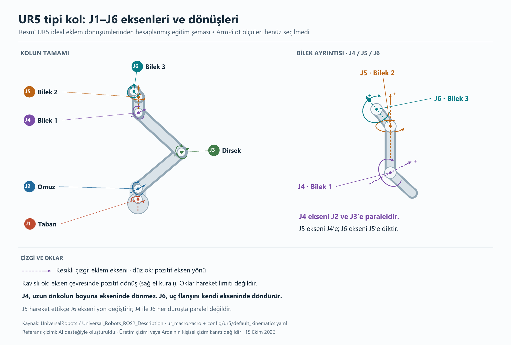

# UR5 eklem eksenleri - ARM-01 öğretici referansı

Güncel ARM-01 kapanışında ayrıca [WE-R2.4 şeması](wer24-joint-axes-reference.png) ve [ayrıntılı açıklama](../arm-01-tasarim-varsayimlari.md) hazırlanmıştır. Aşağıdaki UR5 çizimi ilk öğretici referans olarak korunur; üretim modeli değildir. `generate_ur5_axes.py --model wer24` yayımlanmış WE-R2.4 uyarlamasını, varsayılan komut ise UR5 referansını çizer.

15 Ekim 2026. Bu şema kullanıcının talebiyle, resmî UR5 ideal robot tanımındaki dönüşümlerden hesaplanmıştır. Görsel AI tarafından kodla hazırlanmış öğretici referanstır; Arda'nın elle çizimi veya seçilecek baskı robotunun doğrulanmış geometrisi değildir.

Dosyalar: [PNG](ur5-joint-axes-reference.png), [SVG](ur5-joint-axes-reference.svg), [hesaplanan eksen verisi](ur5-joint-axes-reference.json), [şemayı üreten kaynak](generate_ur5_axes.py).

## Eklem adları ve geometrik ilişkiler

| Etiket | Resmî ROS eklem adı | Açıklama |
| --- | --- | --- |
| J1 | shoulder_pan_joint | Düşey taban ekseni çevresindeki dönüş. |
| J2 | shoulder_lift_joint | Omuz; kolu kaldırma/indirme. |
| J3 | elbow_joint | Dirsek; üst kol ile önkol arasındaki açı. |
| J4 | wrist_1_joint | Birinci bilek; ekseni J2 ve J3'e paraleldir. Uzun önkolu boyuna burma eklemi değildir. |
| J5 | wrist_2_joint | İkinci bilek; ekseni J4'e diktir. |
| J6 | wrist_3_joint | Üçüncü bilek; ekseni J5'e diktir ve uç flanşını kendi ekseninde döndürür. |

J4 ve J6 eksenleri her duruşta paralel değildir; J5 açısı bu ilişkiyi değiştirir. Eksen yönleri önceki eklemler hareket ettikçe dünya koordinatlarında değişir. Şekildeki kesikli çizgiler dönme eksenlerini, düz oklar pozitif eksen yönünü, kavisli oklar sağ el kuralıyla pozitif dönüşü gösterir. Oklar mekanik limit veya sınırsız dönüş iddiası değildir.

Önemli okuma ayrımı: Resmî Xacro dosyasında altı eklem için de `<axis xyz="0 0 1"/>` yazılması, altı eksenin uzayda paralel olduğu anlamına gelmez. Bu vektör her eklemin kendi yerel çerçevesindedir; `origin` dönüşümleriyle taban çerçevesine taşınmalıdır. Şemada bu dönüşümler uygulanmıştır.

## Hesap ve doğrulama

Kullanılan referans model UR5'tir; UR5e boyutlarıyla karıştırılmamıştır. Gösterim pozu derece cinsinden `[0, -45, -120, -15, 55, 0]` olarak seçildi. Bu bir home/kalibrasyon tanımı değildir. Omuz, önkol ve bilek ofsetleri üreticinin ideal UR5 dosyasından alınmıştır. J1 işareti görünürlük için aynı düşey eksen üzerinde daha aşağıda gösterilmiştir. Gövde şekilleri basitleştirilmiştir.

Hesaplanan birim eksenler için J2-J3 ve J3-J4 paralelliği; J4-J5 ve J5-J6 dikliği sayısal olarak kontrol edilir. PNG görseli okunabilirlik ve yerleşim açısından incelendi. Bunlar seçilecek fiziksel robotun ölçüm doğrulaması değildir.

## Kaynaklar

- [Universal Robots resmî URDF/Xacro eklem tanımı](https://github.com/UniversalRobots/Universal_Robots_ROS2_Description/blob/rolling/urdf/ur_macro.xacro): eklem adları, ebeveyn/çocuk zinciri, yerel eksenler ve taban çerçevesi dönüşümü.
- [Resmî UR5 ideal kinematik dönüşümleri](https://github.com/UniversalRobots/Universal_Robots_ROS2_Description/blob/rolling/config/ur5/default_kinematics.yaml): link/origin konum ve yönelimleri.
- [Universal Robots DH parametreleri](https://www.universal-robots.com/articles/ur/application-installation/dh-parameters-for-calculations-of-kinematics-and-dynamics/): UR5 ile UR5e için ayrı boyut tabloları.
- [Resmî robot tanımı belgeleri](https://docs.universal-robots.com/Universal_Robots_ROS2_Documentation/doc/ur_description/doc/index.html): kinematik, görsel, fiziksel ve limit parametrelerinin ayrılması.

Kaynaklar 15 Ekim 2026 tarihinde kontrol edildi. `rolling` dalı zamanla değişebilir; bu şemada kullanılan sayısal değerler üretici kodunu kopyalamadan çizim kaynağında ve JSON çıktısında kayıtlıdır.

## Baskı tasarımına uygulama

Kullanıcı hazır baskı/benzer hazır tasarım kullanacak. Tasarımın bağlantısı, sürümü, lisansı, eksen yerleşimi, gerçek link/ofset boyları ve eklem limitleri seçildikten sonra kaydedilecek. UR5'e benzer görünüm veya yalnız boyut ölçeklemesi; kütle, motor torku, kalibrasyon, limitler ve TCP'nin kendiliğinden doğru olduğu anlamına gelmez. Ürün modeli bu gerçek tasarıma göre tanımlanacak.
